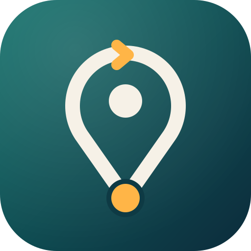

# Out & Back

Formerly "Puglia Transit".

A personal, non-commercial Android app (a WebView around one HTML file) for getting around without a car:
travel mode for Puglia (day trips from Brindisi, last train back, offline maps, shops, weather, travel group)
and a home mode for the Netherlands (departures near you, A→B planner, saved routes, road traffic info).

- `app/assets/index.html`: the whole UI and logic.
- `app/src/`: small Java bridges (GPS, offline map tiles, network, notifications, encrypted group relay).
- `build.sh`: build and sign the APK (see the comments at the top).

## Without internet

Every feature is checked for what still works when the internet is down:
offline maps per city, saved places and descriptions, train/bus estimates and last connections back, the food needs card,
flights (barcode reading and the airport list are built in), group members' last known positions and the album,
posts that wait in an outbox and send automatically later, I'm OK / SOS by text message (SMS) and calls, and an automatic offline group mode: encrypted locations by Bluetooth between nearby phones and by text message to members (max 16 a day per group).
Home mode keeps the last departures, road messages, connections and weather with the time they were saved.

## Data sources and attribution

- Public transport routing: [Transitous](https://transitous.org) (see [its data sources](https://transitous.org/sources/)). Consider [donating](https://transitous.org/donate/).
- Italian trains: Trenitalia (lefrecce), ViaggiaTreno.
- Road traffic in the Netherlands: [NDW open data](https://opendata.ndw.nu) (CC0).
- Map data © [OpenStreetMap contributors](https://www.openstreetmap.org/copyright); vector tiles from [Protomaps](https://protomaps.com); rendering by [MapLibre GL JS](https://maplibre.org) (BSD-3, see `app/assets/map/MAPLIBRE-LICENSE.txt`).
- Places and search: OpenStreetMap via Overpass, Nominatim and Photon; Wikipedia / Wikidata.
- Boarding-pass barcodes: [ZXing](https://github.com/zxing-js/library) (Apache-2.0). Airports: [OurAirports](https://ourairports.com/data/) (public domain).
- Translation of place info: [MyMemory](https://mymemory.translated.net).
- Weather: [Open-Meteo](https://open-meteo.com) (CC BY 4.0).
- Group relay: [ntfy.sh](https://ntfy.sh); messages are end-to-end encrypted (AES-256-GCM) before they leave the phone.

Code: MIT licence (see `LICENSE`). Fonts in `app/assets/map/fonts` are Noto Sans (SIL Open Font Licence).
